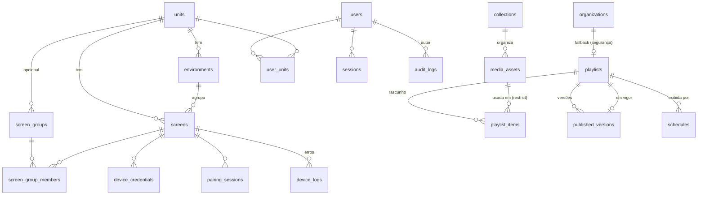

# Data Model — POP TV

Fonte de verdade: `server/migrations/001_init.sql` (e `002_seed.sql` para dados iniciais).

## Mapeamento com as entidades sugeridas no briefing
| Sugerida | Implementação | Por quê |
|---|---|---|
| organizations | `organizations` (1 linha) | guarda playlist de segurança e tolerância offline |
| units, environments, screens, screen_groups, screen_group_members | iguais | — |
| media_assets | `media_assets` + `collections` | coleção editável + etiquetas (`tags[]`) |
| playlists, playlist_items | iguais (itens = rascunho) | — |
| published_versions | igual (snapshot `items` jsonb imutável) | restaurar = nova versão copiada |
| schedules + publication_targets | **`schedules`** (alvo embutido) | publicar = regra sem janela de tempo; um conceito, uma tabela |
| pairing_sessions, device_credentials | iguais (tokens só com hash) | — |
| device_heartbeats | colunas `last_*` em `screens` + `device_logs` (só erros) | evita ~144 mil linhas/dia com 50 TVs |
| users, user_permissions | `users` (papel + liberações) + `user_units` | — |
| audit_logs | igual | — |
| (sessões) | `sessions` | logout e revogação imediata |

## Regras de validação principais
- `schedules.priority` ∈ {10 Padrão, 50 Campanha, 100 Emergência}; Emergência exige `end_at`.
- `start_at`/`end_at` são horário local da unidade da tela (`timestamp` sem fuso); `end_at` exclusivo.
- Janela diária `time_start`–`time_end` pode atravessar a meia-noite (início > fim); `weekdays`
  refere-se ao dia em que a janela começa.
- `playlist_items.media_id` com `on delete restrict`: mídia em uso não pode ser apagada.
- Mídia excluída = `deleted_at` (o objeto permanece para versões antigas poderem ser restauradas).

## Estados
- Mídia: `pending` → (validação) → `ready` | removida se inválida.
- Pareamento: aberto → `claimed_at` (admin confirmou) → `consumed_at` (TV recebeu credencial) | expirado.
- Credencial: ativa → `revoked_at`.
- Tela: online se `last_seen_at` > agora − `offline_after_seconds`.
